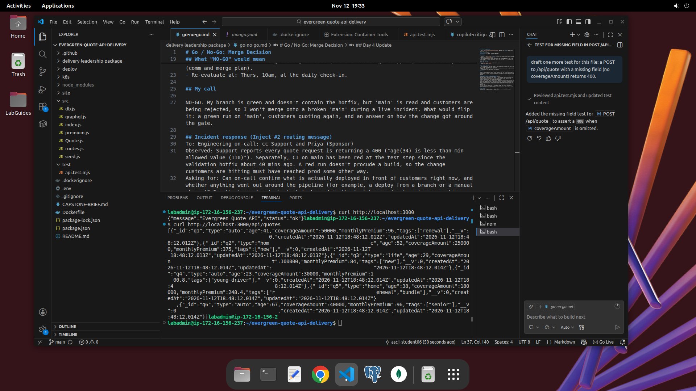

# Delivery Review: Evergreen Quote

> Copy to `delivery-leadership-package/delivery-review-outline.md`. Five slides OR one page. Target: 5 minutes spoken, then 3 minutes of questions.

## Slide 1: Delivery goal & did we hit it?

- Goal (one sentence): By Thursday EOD, the assembled Evergreen Quote API (REST + GraphQL, MongoDB-backed, sponsor's rates) merged to main via a reviewed PR with a green CI, demonstrated in a container and as 3 replicas on Kubernetes.
- Hit? X Yes  ☐ Partially  ☐ No
- One-line "why" either way: PR #12 merged with green CI; container and 3-pod cluster demonstrated.

## Slide 2: What shipped

- Running on 'main' - see screen shot of curl results: 
- [Link to the merged PR.](https://github.com/asc1-student06/evergreen-quote-api-delivery/pull/12)
- Link to the green CI run : https://github.com/asc1-student06/evergreen-quote-api-delivery/actions/runs/43290437461 (install from the lock file with 'npm ci', + then runs 8 tests against a throwaway mongo:7 database).

## Slide 3: Two key decisions

- **Decision 1:** Made the test suite the gate, not manual demos. Why it mattered: the demo showed a tidy 201 with a $.35 premium; only the tests caught the AI-drafted bug.
- **Decision 2:** Said no to renters coverage this week, yes next round. Why it mattered: it was 6 changes, not "one dropdown", and needed a sponsor-set rate; saying yes would have put Thurs merge at risk.
(decision 1 is in 'decision-memo.md' and Decision 2 is in 'status-update.md' and risk8.)

## Slide 4: Risks & injects

- Top risk we tracked: AI-drafted code that looks right but computes wrong (R1). Mitigated by making green CI the merge gate. 
- Inject #1 (Tue): A partner wanted retners by Thurs, plus a moderate CVE on the base image. Deferred renters, shipped on the current image (not internet-exposed, patch next week), and asked the sponsor for 3 things with a deadline.
- Inject #2 (Wed): Customers rejected by an age min of 110; 'main' red after a hotfix. Routed it instead of fixing it. A read run ships nothing, so I asked how the change reached the customers. Called N0-GO; flipped to GO Thursday once 'main' was green.

## Slide 5: What I'd do differently next round

- -Check the kit for hidden files ('.env', '.gitignore', '.dockerignore') on Day 1 before anything else.
- Stop servers at every daily wrap; port 3000 conflicts costs time twice.
- Ask engineering for tests that check *why* a request failed, not just that it returned 400 (from the copilot critique).

## Q&A prep: likely questions

- "Why didn't you ship renters?" - Six changes plus no approved rate; I protected the goal and slotted it for next round.
- "The demo worked all week; why does one red test matter?" -> The demo showed a 201 with a $.35 premium. Tests check the math; demos only check the status code.
-"Why was the cluster's quote list empty?" -> Same Image, different environment. Configuration travels by environment variable; data doesn't travel with the image.